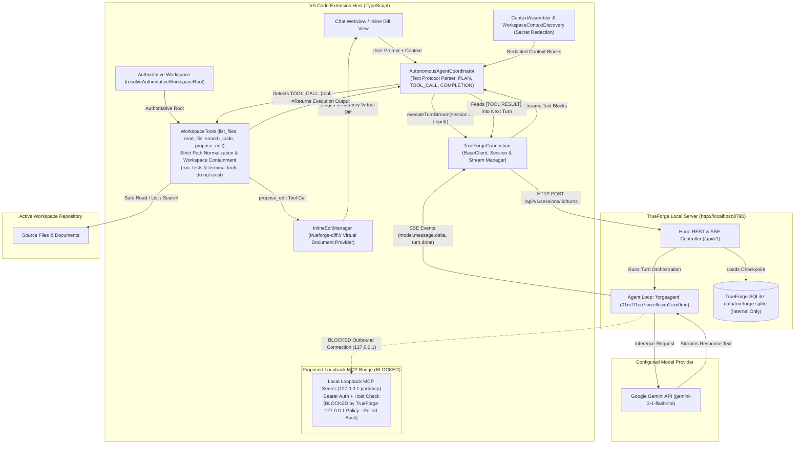

# TrueForge VS Code Extension Architecture Specification
**Techfest Forge-a-thon 2026 Competition Project**  
**Document Version:** 2.2.9 (Pre-Commit Operational & Implementation Alignment)  
**Target Environment:** Windows 11 (win32, x64), Node.js 26.13.1, npm 11.20.0, Git 2.50.1  
**TrueForge Local Server:** `http://localhost:8790` (Version 0.185.1)  
**TrueForge Core Database:** `D:\TrueForge-Forgeathon\data\trueforge.sqlite` (TrueForge-owned; baseline untouched; zero direct access by extension)  
**Configured Model Provider:** `google-gemini` (`google-gemini/gemini-3-1-flash-lite`)  
**Default Agent Name:** `forgeagent` (Immutable Agent ID: `01m7t1cn7kxveffccxp2exv0me`)  

---

## 1. System Vision & Non-Negotiable Core Laws

The TrueForge VS Code Extension is an autonomous, editor-native AI coding assistant built for the Techfest Forge-a-thon 2026.

### Core Architectural Laws
1. **TrueForge as the Sole Agent Harness (Non-Negotiable)**:
   * The extension does **not** implement an independent Gemini, OpenAI, or Anthropic agent loop.
   * All reasoning, iteration limits, session state machines, model calls, and turn orchestration are executed strictly by the TrueForge server (`http://localhost:8790`).
   * In the current operational implementation, autonomous multi-turn tool chaining is coordinated via `AutonomousAgentCoordinator.ts` by parsing structured `PLAN:`, `TOOL_CALL:`, and `COMPLETION:` text blocks from TrueForge model turns and executing local tools in `WorkspaceTools.ts`, feeding `[TOOL RESULT]` back into TrueForge turns. (This is a coordinator-driven structured text protocol, **not** native provider function calling and **not** remote MCP execution).
   * Antigravity is strictly our development environment.
2. **Strict Separation of Identifiers**:
   * **Agent ID**: Immutable server-generated identifier for the agent definition (`01m7t1cn7kxveffccxp2exv0me`).
   * **Session ID**: Distinct conversation instance identifier minted per session by `client.sessions.create()`.
   * **Turn ID**: Specific request-response exchange identifier within a session (`turn_01...`).
   * **Tool-Call ID**: Granular function call identifier generated during a turn.
   * The extension **never** substitutes or hardcodes the Agent ID as a Session ID.
3. **TrueForge Database Ownership & Zero Direct Access**:
   * `data/trueforge.sqlite` is owned exclusively by TrueForge.
   * The extension **never** directly reads, writes, modifies, deletes, or locks this database (zero direct database dependencies, zero direct file handles).
   * All TrueForge interaction must use the official `@truefoundry/trueforge-sdk` and TrueForge HTTP API.
4. **Dynamic Workspace Security Boundary**:
   * The extension is **not** restricted to `D:\TrueForge-Forgeathon`.
   * It dynamically resolves authorized workspace roots from `vscode.workspace.workspaceFolders` via `resolveAuthoritativeWorkspaceRoot` in `src/extension.ts`.
   * It enforces fail-closed protection: if no workspace folder is open, autonomous operations, inline edits, and discovery are disabled with an explicit user notification.
   * Application-level path validation prevents directory traversal, symlink escapes, junction escapes, and cross-drive access.
5. **Local Workspace Tools Implementation vs Proposed Remote MCP Architecture**:
   * **Current Operational Implementation**: Autonomous repository tools (`list_files`, `read_file`, `search_code`, `propose_edit`) are implemented locally in the VS Code extension host in `src/agent/WorkspaceTools.ts` and orchestrated by `src/agent/AutonomousAgentCoordinator.ts`. (Note: `run_tests` and autonomous terminal execution do not exist in the current codebase).
   * **Proposed Remote MCP Architecture (BLOCKED / NOT VERIFIED)**: The original architectural plan to expose tools via a loopback Model Context Protocol (MCP) server on `http://127.0.0.1:<port>/mcp` registered via `client.settings.mcpServers.createOrUpdate` was blocked at runtime by TrueForge's outbound URL validation policy (restricting requests to `127.0.0.1` / `localhost`). The experimental registration was rolled back cleanly. The extension does **not** currently register a remote MCP server, attach MCP tools to sessions, or rely on MCP for autonomous operations. The current local tool protocol does **not** satisfy native MCP integration. Loopback bridge code (`LocalMcpBridge.ts`, `McpSecurity.ts`) is preserved as a proposed future integration plan pending TrueForge policy updates.

---

## 2. Requirement Classification & Verification Tiers

### 2.1 Requirement Classification
* **Product Mandatory Capability**: The five core assistant capabilities defined in the project specification:
  1. Inline Editing
  2. Autonomous Agent Mode
  3. Intelligent Context Assembly
  4. Safe Diff Review
  5. Streaming and Cancellation
* **Competition Evaluation Rubric**: Evaluation criteria derived from published Techfest Forge-a-thon Round 1 guidelines (evaluated against `pallets/flask`).
* **Architectural Interpretation**: Technical designs formulated to fulfill mandatory capabilities faithfully.
* **Internal Evaluation Scenario**: Concrete test scenarios designed by our team to demonstrate capability on the evaluation repo.

### 2.2 Five-Tier Verification Framework

| Tier | Definition | Meaning |
| :--- | :--- | :--- |
| **Tier 1: Source-Code Verified** | Confirmed by reading package implementation code in `trueforge-core` or `trueforge`. | Implementation logic confirmed in installed package files. |
| **Tier 2: SDK Declaration Verified** | Confirmed by reading TypeScript `.d.ts` declaration files in `@truefoundry/trueforge-sdk`. | Contract types, parameters, and return types confirmed. |
| **Tier 3: Runtime Verified / Blocked** | Confirmed by live execution or active probing against running TrueForge server or OS. | Operating environment behavior or security block confirmed. |
| **Tier 4: Live Verified / End-to-End Tested** | Confirmed by complete automated, live model execution, or visual interactive test passing end-to-end. | Complete integration pipeline validated in live environment. |
| **Tier 5: Pending Implementation / Unimplemented** | Architecture specified, verified against interfaces, scheduled for implementation. | Design complete; execution to be validated in planned phase. |

### Technical Verification Status Table

| Technical Element | Verification Tier | Evidence Source & Scope |
| :--- | :--- | :--- |
| **TrueForge Server Baseline** | **Tier 3: Runtime Verified** | Local server running at `http://localhost:8790`; version 0.185.1 verified. |
| **TrueForge SQLite Baseline** | **Tier 3: Runtime Verified** | `data/trueforge.sqlite` verified via read-only PRAGMA inspection; timestamp & hash pristine. |
| **MCP Server SQLite Persistence** | **Tier 1: Source-Code Verified** | `main.js` lines 16087–16140 (`putHandler`) and lines 6453–6465 (`upsertServer`). Experimental registration rolled back. |
| **MCP Server SQLite Deletion** | **Tier 1: Source-Code Verified** | `main.js` lines 16142–16190 (`deleteHandler`) and lines 6466–6470 (`deleteServer`). Calls `DELETE FROM mcp_server`. |
| **Extension Zero Direct DB Access** | **Tier 4: Live Verified** | Extension maintains zero direct database dependencies or file handles; verified via AST audit. |
| **Extension Harness Compliance** | **Tier 4: Live Verified** | Zero direct LLM SDK calls in extension; all turns dispatched through TrueForge server (`http://localhost:8790`). |
| **Server Identifier Distinction** | **Tier 4: Live Verified** | Distinct agent ID (`01m7t1cn7kxveffccxp2exv0me`) and dynamic session IDs verified in live turns. |
| **Workspace Root Isolation** | **Tier 4: Live Verified** | Dynamic workspace root resolution with fail-closed protection verified in Extension Development Host. |
| **Autonomous Tool Chaining** | **Tier 4: Live Verified** | Multi-turn chaining of `list_files`, `read_file`, and `search_code` executed by coordinator against TrueForge. |
| **Inline Diff Proposal & Staging** | **Tier 4: Live Verified** | `propose_edit` stages replacement in `InlineEditManager` under `trueforge-diff://` without touching disk. |
| **Diff Reject Workflow** | **Tier 4: Visually Verified** | Rejection visually verified in Extension Development Host; proposal cleared, original file remained unchanged in observed test (no automated hash assertion in live extension). |
| **Diff Accept Workflow** | **Tier 4: Visually Verified & Saved** | Acceptance applies edit cleanly to disk via `vscode.WorkspaceEdit` (standard VS Code batch edit; fault-tested atomicity under write failures is not claimed). |
| **Client Cooperative Cancellation** | **Tier 4: Live Verified** | Live SSE token streaming and coordinator cooperative turn cancellation verified. |
| **Server Cancellation Confirmation** | **Tier 5: Pending Verification** | Confirmation of server-side turn cancellation state in TrueForge remains pending. |
| **Context Assembly & Redaction** | **Tier 4: Live Verified (Editor Context)** | `ContextAssembler` extracts active editor range, diagnostics, and redacts sensitive API keys. |
| **MCP End-to-End Execution** | **BLOCKED / NOT VERIFIED (Tier 3 Runtime Blocked)** | TrueForge server outbound URL policy blocks connections to `127.0.0.1`; registration rolled back. Local tool protocol does not satisfy native MCP integration. |
| **Test Execution Tool (`run_tests`)** | **Tier 5: Unimplemented in Current Release** | `WorkspaceTools.ts` implements file and diff tools only; process execution and terminal execution tools do not exist. |
| **HTTP Transport Retries (`maxRetries: 2`)** | **Tier 1 / Tier 2 Verified** | Handled automatically by SDK for initial HTTP requests; does not cover mid-stream SSE recovery or turn replay. |
| **Turn-Level 503 Resilience Retries** | **Tier 5: Pending Implementation** | Partial-turn 503 state recovery pending dedicated resilience testing. |

---

## 3. High-Level Architecture Diagram

---

## 4. Current Local Tool Architecture vs Proposed Remote MCP Architecture

### 4.1 Current Working Implementation: Local WorkspaceTools & Structured Text Protocol

In the operational extension, autonomous agent capabilities are implemented locally in the VS Code extension host rather than through a remote MCP server:

1. **Local Tool Suite (`src/agent/WorkspaceTools.ts`)**:
   * `list_files(directory)`: Recursively lists workspace files respecting `.gitignore`, binary exclusions, and directory depth limits.
   * `read_file(filePath, startLine, endLine)`: Reads text files within the workspace boundary with line range limits.
   * `search_code(query, directory, filePattern)`: Searches workspace files for text or regex patterns.
   * `propose_edit(filePath, replacementContent, explanation)`: Stages proposed modifications in memory via `InlineEditManager` without touching disk.
   * All tools enforce strict workspace boundary containment via `path.resolve` against `authoritativeWorkspaceRoot`.
   * **Scope Boundary**: `run_tests` and autonomous terminal execution are **not implemented** in the current extension codebase.
2. **Autonomous Coordinator Loop (`src/agent/AutonomousAgentCoordinator.ts`)**:
   * Initiates multi-turn autonomous loops targeting TrueForge agent `forgeagent` via `executeTurnStream()`.
   * Injects system instructions detailing available tools and exact text formatting protocol:
     * `PLAN:` Step-by-step reasoning.
     * `TOOL_CALL: { "tool": "<name>", "arguments": { ... } }`
     * `COMPLETION:` Summary of task completion.
   * Parses streamed text blocks using regex and JSON validation.
   * Dispatches tool calls to `WorkspaceTools.ts` locally within the extension host.
   * Formats execution output as `[TOOL RESULT for <tool>]: ...` and feeds it into the next turn.
   * Manages max turn bounds (default 10) and client-side cooperative cancellation.
3. **Protocol Distinction**:
   * This is a coordinator-mediated structured text protocol.
   * It is **not** native model provider function calling (which depends on provider-specific JSON schemas).
   * It is **not** remote MCP tool execution, and the local tool protocol does **not** satisfy native MCP integration.

### 4.2 Proposed Remote MCP Architecture & Runtime Policy Block

#### Intended Architecture (`src/mcp/LocalMcpBridge.ts`, `src/mcp/McpSecurity.ts`)
The original design intended to expose workspace tools to TrueForge via a loopback Model Context Protocol (MCP) server:
* Loopback HTTP server running in extension host on `http://127.0.0.1:<port>/mcp`.
* Authenticated via ephemeral per-instance bearer token (`Authorization: Bearer <token>`).
* Registered with TrueForge server via `client.settings.mcpServers.createOrUpdate()`.
* TrueForge agent would call the MCP server using `streamable-http` transport.

#### Runtime Verification Finding: BLOCKED / NOT VERIFIED
* During runtime validation against the live TrueForge server (v0.185.1), TrueForge rejected outbound connections to `127.0.0.1` and `localhost` under its outbound SSRF/URL policy.
* TrueForge's internal HTTP client restricts outbound requests targeting private/loopback IP addresses to prevent SSRF vulnerabilities.
* Consequently, remote MCP registration failed and could not be used for tool dispatch.

#### Safe Rollback & Current Status
* The experimental MCP registration was rolled back cleanly via `client.settings.mcpServers.delete()`.
* The extension does **not** currently register a remote MCP server, attach MCP tools to sessions, or rely on MCP for autonomous operations.
* The current local tool protocol does not satisfy native MCP integration.
* Loopback MCP code in `src/mcp/LocalMcpBridge.ts` and `src/mcp/McpSecurity.ts` is preserved as a proposed future integration plan pending TrueForge outbound policy configuration or proxy support.

---

## 5. Security & Boundary Enforcement Architecture

### 5.1 Dynamic Workspace Security Boundary (`src/context/WorkspaceContextDiscovery.ts`, `src/extension.ts`)
1. **Dynamic Authorized Roots**:
   * Dynamically resolved from `vscode.workspace.workspaceFolders`.
   * Enforces fail-closed behavior: if no workspace folder is open, autonomous operations and inline edits fail closed with an explicit user notification.
2. **Path Traversal & Escape Prevention**:
   * Resolves canonical physical paths via `path.resolve`.
   * Normalizes paths and validates that target paths strictly start with `authoritativeWorkspaceRoot`.
   * Rejects path traversal sequences (`../`, `..\`).
3. **Protected Files & Database Shielding**:
   * Prohibits reading or modifying protected system and extension files: `.git`, `node_modules`, `data/trueforge.sqlite`, `.env`, and private key formats.
   * Enforces zero direct access to TrueForge database files.

### 5.2 Non-Destructive Diff Staging & Human Approval (`src/diff/InlineEditManager.ts`)
1. **In-Memory Proposal Staging**:
   * Proposed file changes generated by `propose_edit` are staged entirely in memory inside `InlineEditManager`.
   * Staged content is registered under virtual URI scheme `trueforge-diff://proposed/<filename>`.
   * Zero bytes are written to the target file on disk during proposal staging; original file remains untouched.
2. **Native VS Code Diff Review**:
   * Extension invokes `vscode.diff` between the original disk file and the virtual proposed document.
   * Provides user controls: "Accept Edit" and "Reject Edit" in editor title bar and QuickPick dialog.
3. **Reject Verification**:
   * Rejecting clears the pending in-memory proposal and closes the diff view.
   * The original disk file was visually confirmed to remain unchanged in testing (no automated hash assertion in live extension).
4. **Accept Verification**:
   * Accepting applies the replacement content using `vscode.WorkspaceEdit` and saves the file to disk (standard VS Code batch edit; fault-tested atomicity under write failures is not claimed).

### 5.3 Windows Process Execution Security (Proposed Design - Unimplemented)
* Process execution via `run_tests` / `TestTools` and autonomous terminal execution are **unimplemented** in the current release.
* `WorkspaceTools.ts` implements file and diff tools only (`list_files`, `read_file`, `search_code`, `propose_edit`).
* When implemented in a future release, process execution will follow strict security constraints: argument arrays with `shell: false`, working directory validation, execution timeouts, output capping, and explicit modal user confirmation.

---

## 6. Resilience, Retries, and Turn Safety

### 6.1 Transport Retries & SSE Reconnection
* **HTTP Transport Retries**: Handled automatically by `@truefoundry/trueforge-sdk` (`maxRetries: 2` in `requestWithRetries.js:15`). Note: this covers initial HTTP request fetching (retrying on 408, 429, >=500); it does **not** guarantee mid-stream SSE connection recovery or model-turn replay on 503 capacity errors. Custom HTTP retries are prohibited.
* **SSE Reconnection**: Handled by SDK's built-in `Stream.js` reconnection logic (`DEFAULT_MAX_RECONNECTION_ATTEMPTS = 5`, exponential backoff).

### 6.2 Turn Safety & Cancellation
* **Cooperative Cancellation**: User cancellation sets an internal flag in `AutonomousAgentCoordinator`, immediately halting the local tool execution loop and unlocking the UI. The coordinator issues `cancelTurn()` to TrueForge; however, server-side cancellation confirmation (asserting that TrueForge server transitioned the turn checkpoint to a cancelled state) has not been verified and remains pending.
* **Turn-Level 503 Retries (Resilience Testing Pending)**:
  * Inspection of turn state via `client.sessions.getTurn(sessionId, turnId)` prior to re-executing errored turns is architected to prevent duplicate tool execution.
  * Turn-level partial-turn retry and fault-injection testing remain scheduled for the dedicated resilience testing phase.

---

## 7. Competition Benchmarking Strategy & Acceptance Criteria

### 7.1 Decoupling Competition Tasks from Internal Scenarios
* **Five Product Mandatory Capabilities**:
  1. Inline Editing
  2. Autonomous Agent Mode
  3. Intelligent Context Assembly
  4. Safe Diff Review
  5. Streaming and Cancellation
* **Round 1 Evaluation Focus Areas**:
  1. Inline Editing
  2. Autonomous Agent Mode
  3. Resilience to model/provider failures
* **Internal Evaluation Repository**: `pallets/flask` (Official Round 1 target).

### 7.2 Realistic Test Pass-Rate Criteria
* Upstream `pallets/flask` contains hundreds of tests, some requiring optional OS packages or tox environments. Demanding 100% full-suite pass rate is technically invalid.
* **Realistic Rubric**:
  1. **Baseline**: Run targeted test suite on unmodified clone to record passing baseline (e.g. `pytest tests/test_basic.py`).
  2. **Targeted Tests**: 100% pass rate on tests directly covering the modified feature.
  3. **Regression Tests**: 0 regressions on all baseline-passing tests.
  4. **Full Suite**: Informational report recorded for evaluation write-up.

---

## 8. Revision History

| Version | Date | Changes / Notes |
| :--- | :--- | :--- |
| 2.2.9 | 2026-11-20 | **Pre-Commit Documentation & Operational Alignment**: (1) Updated Core Architectural Laws (Law 1 and Law 5) to distinguish current working local tool implementation from proposed remote MCP architecture, noting local protocol does not satisfy native MCP. (2) Updated Section 2.2 Technical Verification Status Table: marked diff rejection as visually verified without SHA-256 assertion claims; marked diff acceptance as `WorkspaceEdit` application without claiming fault-tested atomicity; marked client cooperative cancellation verified and server-side cancellation confirmation as pending; marked MCP end-to-end execution as BLOCKED / NOT VERIFIED (Tier 3 Runtime Blocked). (3) Annotated Section 3 high-level architecture diagram showing operational coordinator tool dispatch path and blocked remote MCP path. (4) Re-titled and updated Section 4 to contrast local WorkspaceTools / structured text protocol with proposed remote MCP architecture, documenting the TrueForge 127.0.0.1 outbound policy block and clean rollback. (5) Explicitly stated that `run_tests` and autonomous terminal execution do not exist in current codebase. (6) Qualified SDK `maxRetries: 2` to apply strictly to initial HTTP requests. |
| 2.2.8 | 2026-11-19 | **Session Lifecycle & Rebinding Hardening**: (1) Investigated session rebinding (`sessions.update`): classified as Tier 2 SDK / Tier 1 Code verified, but Tier 5 Unverified at runtime. (2) Defined explicit lifecycle across activations and reloads: sessions tied to a prior instance's registration must not execute repository tools; restored sessions display historical transcripts in read-only mode; active turns trigger fresh Option A sessions bound to `vscode-tools-${currentInstanceId}` with `workspaceState` migration. (3) Reaffirmed clean deactivation deletes only own registration and interrupted shutdowns remain under manual cleanup. |
| 2.2.7 | 2026-11-19 | **Phase 0 Final Refinements**: (1) Defined consistent session creation strategy across all phases (Phase 1–7): Option A inline session specification preferred without mutating registry agent. (2) Clarified stale-registration policy: automatic PID-based cleanup marked as unimplemented; stale registrations kept manual. |
| 2.2.6 | 2026-11-19 | Phase 0 Final Sign-Off Hardening: Corrected database and token persistence wording; hardened cleanup policy; confirmed Phase 3 replaces smoke-test tool with production suite. |
| 2.2.5 | 2026-11-19 | Phase 0 Finalization: Updated Phase 1 MCP smoke test with unified 7-step sequence and single parameter-free schema. |
| 2.2.4 | 2026-11-19 | Verified TrueForge MCP persistence in SQLite `mcp_server` table via source inspection. |
| 2.2.3 | 2026-11-19 | Hardened temporary Phase 1 smoke-test tool and corrected verification tier overclaims. |
| 2.2.2 | 2026-11-19 | Introduced temporary minimal read-only smoke-test tool to decouple Phase 1 transport verification from Phase 3 tool suite. |
| 2.2.1 | 2026-11-19 | Verified inline agent spec contract in SDK and corrected token disposal specifications. |
| 2.2.0 | 2026-11-19 | Comprehensive Phase 0 architectural revision for Techfest Forge-a-thon. |
