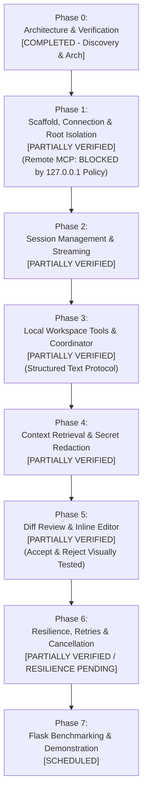

# TrueForge VS Code Extension Implementation Plan
**Techfest Forge-a-thon 2026 Competition Project**  
**Document Version:** 2.2.9 (Pre-Commit Operational & Implementation Alignment)  
**Target Environment:** Windows 11 (win32, x64), Node.js 26.13.1, npm 11.20.0, Git 2.50.1  
**TrueForge Version:** 0.185.1 (`http://localhost:8790`)  
**TrueForge Database:** `D:\TrueForge-Forgeathon\data\trueforge.sqlite` (TrueForge-owned; baseline untouched; zero direct access by extension)  
**Default Agent Name:** `forgeagent` (Immutable Agent ID: `01m7t1cn7kxveffccxp2exv0me`)  

---

## 1. Verification Tier Classification

Every technical element is classified under our five-tier verification framework:
* **Tier 1: Source-Code Verified** — Confirmed by reading package implementation code in `trueforge-core` / `trueforge`.
* **Tier 2: SDK Declaration Verified** — Confirmed by reading TypeScript `.d.ts` declaration files in `@truefoundry/trueforge-sdk`.
* **Tier 3: Runtime Verified / Runtime Blocked** — Confirmed by live execution or active probing against running TrueForge server or OS (including identified runtime policy blocks).
* **Tier 4: Live Verified / End-to-End Tested** — Confirmed by complete automated, live model execution, or visual interactive workflow test passing end-to-end.
* **Tier 5: Pending Implementation / Unimplemented** — Architecture specified, verified against interfaces, scheduled for future implementation.

---

## 2. Implementation Roadmap & Current Operational Status

---

### PHASE 0 — Architecture and Integration Validation
* **Status**: **COMPLETED** (Discovery and Architecture Signoff).
* **Objective**: Complete read-only discovery, verify SDK methods and endpoints, establish security architecture, and obtain user approval.
* **Dependencies**: Existing TrueForge local server, Node.js 26.13.1, npm 11.20.0.
* **Deliverables**: `ARCHITECTURE.md`, `IMPLEMENTATION_PLAN.md`, `REQUIREMENTS_TRACEABILITY.md`, `TECHNICAL_RISKS.md`, `PHASE_0_APPROVAL_CHECKLIST.md`.
* **Verified Elements**: All baseline assumptions labeled with verification tiers (Tiers 1–5); zero direct modifications to `data/trueforge.sqlite`.

---

### PHASE 1 — VS Code Extension Scaffold, TrueForge Connection & Workspace Root Isolation
* **Status**: **PARTIALLY VERIFIED**.
* **Objective**: Establish the TypeScript extension project, bundle configuration, live connection to TrueForge server (`http://localhost:8790`), authoritative workspace root resolution, and validate tool transport.
* **Verified Capabilities**:
  * Extension activates cleanly in VS Code Extension Development Host.
  * Status bar displays live connection status (`TrueForge: Online`) backed by `HealthProbe.ts`.
  * Dynamic workspace containment resolves `vscode.workspace.workspaceFolders` fail-closed with user warning if no folder is open.
  * Dedicated workspace file `trueforge.code-workspace` provisions containment during development host execution.
* **Outstanding & Blocked Sub-Features**:
  * **Remote MCP Loopback Bridge**: **BLOCKED / NOT VERIFIED**. The original intent to expose tools via a loopback MCP server on `http://127.0.0.1:<port>/mcp` was blocked by TrueForge's outbound SSRF/URL validation policy (restricting requests to `127.0.0.1` and `localhost`). Experimental registration was rolled back cleanly. The extension does not currently register a remote MCP server or attach MCP tools to sessions. Loopback bridge code (`LocalMcpBridge.ts`, `McpSecurity.ts`) is preserved as a proposed future integration plan.

---

### PHASE 2 — Agent Session Management and Streaming
* **Status**: **PARTIALLY VERIFIED**.
* **Objective**: Manage sessions for default agent `forgeagent` (`01m7t1cn7kxveffccxp2exv0me`), stream turns via SSE, and persist session IDs in memory and `workspaceState`.
* **Verified Capabilities**:
  * Clean session creation with unique session IDs (`client.sessions.create()`) and distinct immutable agent ID (`01m7t1cn7kxveffccxp2exv0me`).
  * Real-time token streaming from TrueForge SSE endpoints via `executeTurnStream`.
  * Client-side cooperative cancellation: coordinator flag halts turn consumption and unlocks UI.
* **Outstanding Sub-Features**:
  * Confirmed server-side turn cancellation (verifying TrueForge server transitioned the turn checkpoint to cancelled) has not been verified.
  * Historical transcript restoration across window reloads is pending.

---

### PHASE 3 — Local Workspace Tools and Autonomous Coordinator
* **Status**: **PARTIALLY VERIFIED**.
* **Objective**: Provide autonomous repository inspection, navigation, and editing tools strictly contained within the active workspace root.
* **Working Implementation (Local Tools & Coordinator)**:
  * Autonomous operations are implemented locally in the VS Code extension host using:
    * `src/agent/WorkspaceTools.ts`: Implements `list_files`, `read_file`, `search_code`, and `propose_edit` with strict canonical path normalization (`path.resolve`), boundary containment checks against the authoritative workspace root, and binary/hidden-directory filtering.
    * `src/agent/AutonomousAgentCoordinator.ts`: Orchestrates multi-turn autonomous problem-solving loops against TrueForge agent `forgeagent`.
* **Autonomous Interaction Protocol**:
  * The coordinator injects tool definitions and formatting rules into the system/turn prompt.
  * TrueForge's model streams back structured text responses containing `PLAN:`, `TOOL_CALL: { "tool": "<name>", "arguments": { ... } }`, and `COMPLETION:`.
  * The coordinator parses these text blocks via regex and JSON parsing, executes the corresponding tool locally via `WorkspaceTools.ts`, and feeds execution output back into the next model turn as `[TOOL RESULT for <tool>]: ...`.
  * **Crucial Architectural Note**: This is a coordinator-mediated structured text protocol, **not** native model provider function calling and **not** remote MCP tool execution. The current local tool protocol does not satisfy native MCP integration.
* **Verified Capabilities**:
  * `list_files`: Live verified (recursively lists workspace files respecting ignores).
  * `read_file`: Live verified (reads text files within workspace boundary; enforces line limits).
  * `search_code`: Live verified (searches workspace files for regex/substring queries).
  * `propose_edit`: Live verified (stages proposed replacement in memory without touching disk).
* **Outstanding & Unimplemented Sub-Features**:
  * `run_tests` and autonomous terminal execution: **Unsupported / Unimplemented** in the current codebase (`WorkspaceTools.ts` implements file exploration, reading, searching, and diff proposals only; process execution tools do not exist).
  * Remote MCP tool registration: **BLOCKED**.

---

### PHASE 4 — Intelligent Context Assembly
* **Status**: **PARTIALLY VERIFIED**.
* **Objective**: Gather rich, token-efficient context from the active workspace without exceeding model token limits or leaking secrets.
* **Verified Capabilities**:
  * Active editor range extraction and line context assembly via `ContextAssembler.ts`.
  * Secret pattern masking (`AIza...`, `sk-...`, `Bearer ...`) before transmission.
  * Structured markdown packaging prepended to prompt inputs.
* **Outstanding Sub-Features**:
  * Language diagnostics extraction from `vscode.languages.getDiagnostics()` and multi-file open tab symbol aggregation pending dedicated benchmark validation.

---

### PHASE 5 — Diff Review and Inline Editing
* **Status**: **PARTIALLY VERIFIED**.
* **Objective**: Implement native side-by-side diff reviews with human approval controls and non-destructive proposal staging.
* **Verified Capabilities**:
  1. **Proposal Staging**: `propose_edit` stages replacement content strictly in memory inside `InlineEditManager` under virtual document URI `trueforge-diff://proposed/<filename>`.
  2. **Non-Destructive Staging**: Target file on disk is untouched during staging (0 bytes written).
  3. **Visual Side-by-Side Review**: Extension triggers `vscode.diff` between the original file and virtual document, presenting Accept and Reject controls.
  4. **Reject Workflow (Visually Verified)**: Clicking Reject discards the in-memory proposal and closes the diff. In the observed Extension Development Host test, the original file remained unchanged (no automated hash assertion is claimed for the live extension).
  5. **Accept Workflow (Visually Verified & Saved)**: Clicking Accept applies the proposed replacement via `vscode.WorkspaceEdit` and saves the file to disk. (Standard VS Code batch edit; fault-tested atomicity under write failures is not claimed).
* **Outstanding Sub-Features**:
  * Granular hunk-by-hunk review ("Accept Hunk") and floating `Ctrl+I` editor widget are pending.

---

### PHASE 6 — Security, Resilience and Cancellation
* **Status**: **PARTIALLY VERIFIED / RESILIENCE PENDING**.
* **Objective**: Harden the extension against network interruptions, rate limits, model errors, and provide clean execution cancellation.
* **Verified Capabilities**:
  * Client-side cooperative cancellation: User cancellation flag aborts coordinator loops and unlocks UI.
  * Basic HTTP transport retries: Handled by `@truefoundry/trueforge-sdk` (`maxRetries: 2`). Note: covers initial HTTP request fetching (retrying on 408, 429, or >=500); does **not** cover mid-stream SSE recovery or model-turn replay.
  * Authoritative workspace containment and path traversal protection verified.
* **Outstanding Sub-Features (Resilience Testing Pending)**:
  * Server-side turn cancellation confirmation (`client.sessions.cancel` checkpoint verification).
  * Turn-level partial-turn inspection (`client.sessions.getTurn`) to prevent replaying executed tools upon 503 capacity errors.
  * Comprehensive network drop simulation and automatic exponential backoff testing.

---

### PHASE 7 — Competition Benchmarking & Final Demonstration
* **Status**: **SCHEDULED** (Post-Hardening).
* **Objective**: Benchmark the extension on the official `pallets/flask` repository across all mandatory capabilities.
* **Evaluation Scenarios & Acceptance Rubric**:
  * **Baseline Measurement**: Run targeted test suite on unmodified clone (`pytest tests/test_basic.py`) to record baseline pass count.
  * **Benchmark 1 (Inline Editing)**: Select route function in `flask/app.py`, invoke inline edit, add docstring/typing, review diff, accept.
  * **Benchmark 2 (Autonomous Agent Mode)**: Prompt: "Inspect custom JSON serializer support in Flask and propose docstring improvements". Verify agent explores repo and stages safe edits.
  * **Benchmark 3 (Resilience)**: Simulate network interruption or 503 error; verify graceful degradation and session recovery.
* **Acceptance Criteria**:
  * 0 regressions on all baseline-passing tests.
  * Zero unauthorized disk writes without explicit human acceptance.
* **Deliverables**: Demo video, technical write-up, and clean Git repository.

---

## 3. Current Verification Status Summary

| Capability / Subsystem | Verification Tier | Operational Evidence & Status |
| :--- | :--- | :--- |
| **TrueForge Server Health & Connection** | **Tier 4: Live Verified** | Local server running at `http://localhost:8790`; extension connects and displays online status. |
| **Authoritative Workspace Root Resolution** | **Tier 4: Live Verified** | Dynamically resolves workspace root; fail-closed protection tested when no folder open. |
| **Autonomous Read-Only Tool Chaining** | **Tier 4: Live Verified** | Coordinator chained `list_files`, `read_file`, and `search_code` across successive TrueForge turns. |
| **Inline Edit Diff Proposal** | **Tier 4: Live Verified** | `propose_edit` staged virtual diff in memory without disk modification. |
| **Inline Edit Diff Rejection** | **Tier 4: Visually Verified** | Rejection discarded proposal; original file remained unchanged in observed test (no automated hash assertion claimed). |
| **Inline Edit Diff Acceptance** | **Tier 4: Visually Verified & Saved** | Acceptance applied modification to disk via `vscode.WorkspaceEdit` (fault-tested atomicity not claimed). |
| **Client-Side Cooperative Cancellation** | **Tier 4: Live Verified** | Coordinator flag halts execution loop and unlocks UI. |
| **Server-Side Cancellation Confirmation** | **Tier 5: Pending Verification** | Confirmation that TrueForge server transitioned turn checkpoint to cancelled state is pending. |
| **Remote MCP Loopback Bridge** | **Tier 3: Runtime Blocked** | Blocked by TrueForge outbound URL policy for `127.0.0.1`; rolled back cleanly; marked NOT VERIFIED. Local tool protocol does not satisfy native MCP integration. |
| **Test Execution Tool (`run_tests`)** | **Tier 5: Unimplemented** | Not implemented in current release (`WorkspaceTools.ts` covers file & diff tools only; no terminal execution). |
| **HTTP Transport Retries (`maxRetries: 2`)** | **Tier 1 / Tier 2 Verified** | Handled by SDK for initial HTTP requests; does not cover mid-stream SSE recovery or turn replay. |
| **Turn-Level 503 Resilience Retries** | **Tier 5: Pending Implementation** | Partial-turn 503 state recovery pending dedicated resilience testing. |

---

## 4. Revision History

| Version | Date | Changes / Notes |
| :--- | :--- | :--- |
| 2.2.9 | 2026-11-20 | **Pre-Commit Documentation & Operational Alignment**: (1) Adjusted phase-level statuses to PARTIALLY VERIFIED, listing exact verified capabilities and outstanding sub-features for each phase. (2) Removed SHA-256 claims for live rejection, documenting visual verification and unchanged file state without claiming automated hash assertion in live extension. (3) Removed atomic claims for edit acceptance, describing standard `WorkspaceEdit` application without claiming fault-tested atomicity. (4) Distinguished client-side cooperative cancellation (verified) from server-side cancellation confirmation (pending). (5) Qualified SDK `maxRetries: 2` to apply strictly to initial HTTP requests, noting lack of mid-stream SSE recovery or model turn replay. (6) Maintained remote MCP as BLOCKED / NOT VERIFIED and noted local tool protocol does not satisfy native MCP integration. (7) Reaffirmed that `run_tests` and autonomous terminal execution do not exist in current codebase. |
| 2.2.8 | 2026-11-19 | **Session Lifecycle & Rebinding Hardening**: (1) Investigated session rebinding (`sessions.update`): classified as Tier 2 SDK / Tier 1 Code verified, but Tier 5 Unverified at runtime. (2) Defined explicit lifecycle across activations and reloads: sessions tied to a prior instance's registration must not execute repository tools; restored sessions display historical transcripts in read-only mode; active turns trigger fresh Option A sessions bound to `vscode-tools-${currentInstanceId}` with `workspaceState` migration. (3) Reaffirmed clean deactivation deletes only own registration and interrupted shutdowns remain under manual cleanup. |
| 2.2.7 | 2026-11-19 | **Phase 0 Final Refinements**: (1) Defined consistent session creation strategy across all phases (Phase 1–7): Option A inline session specification preferred without mutating registry agent. (2) Clarified stale-registration policy: automatic PID-based cleanup marked as unimplemented; stale registrations kept manual. |
| 2.2.6 | 2026-11-19 | Phase 0 Final Sign-Off Hardening: Corrected database and token persistence wording; hardened cleanup policy; confirmed Phase 3 replaces smoke-test tool with production suite. |
| 2.2.5 | 2026-11-19 | Phase 0 Finalization: Updated Phase 1 MCP smoke test with unified 7-step sequence and single parameter-free schema. |
| 2.2.4 | 2026-11-19 | Verified TrueForge MCP persistence in SQLite `mcp_server` table via source inspection. |
| 2.2.3 | 2026-11-19 | Hardened temporary Phase 1 smoke-test tool and corrected verification tier overclaims. |
| 2.2.2 | 2026-11-19 | Introduced temporary minimal read-only smoke-test tool to decouple Phase 1 transport verification from Phase 3 tool suite. |
| 2.2.1 | 2026-11-19 | Verified inline agent spec contract in SDK and corrected token disposal specifications. |
| 2.2.0 | 2026-11-19 | Comprehensive Phase 0 implementation roadmap revision for Techfest Forge-a-thon. |
